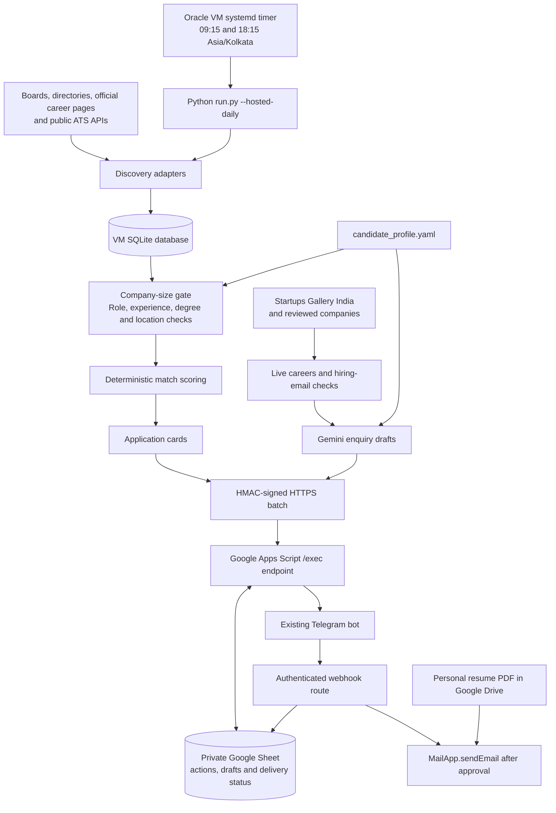

# Outreach platform architecture and workflow

Code snapshot updated 20 November 2026. The base update was deployed to the Oracle VM with migration 61d8c09ea421; the live validation result and any final follow-up are recorded in docs/DAILY_DIGEST_IMPROVEMENTS.md. This update does not change Code.gs. Runtime secrets are omitted.

## 1. Purpose and current deployment

The platform helps Siddharth Ranka find technical internships and early-career opportunities at small companies, review opportunities on Telegram, and approve cold enquiry emails with a resume attachment.

The main operational path is:

1. An Oracle Cloud Ubuntu VM starts a Python discovery run twice a day.
2. Source adapters fetch company and job records.
3. The application normalizes and stores records in SQLite.
4. Company-size and candidate-eligibility filters determine which jobs can enter the shortlist.
5. Deterministic scoring orders those jobs against the candidate profile.
6. A separate careers-research pass looks for public hiring inboxes for potential enquiries.
7. Gemini creates a limited number of enquiry drafts.
8. Python sends a signed batch to the existing Google Apps Script web app.
9. Apps Script checks the private Google Sheet for previous actions and sends eligible Telegram cards.
10. Telegram webhook callbacks update saved actions, accept draft edits, and send an approved email through Google MailApp with the Drive resume attached.

The product target is 25–30 or more applications or outreach attempts per day. The implementation has no guaranteed daily supply of qualifying opportunities. A run may finish with zero delivered cards.

## 2. Architecture diagram



The Python discovery process runs on the VM. Telegram interaction handling runs in Apps Script, so buttons can be used from the phone between discovery runs.

## 3. Source inventory

### 3.1 Sources enabled in sources.yaml

The original discovery sources remain, with Remotive re-enabled, seven enabled Consider portfolios, HN, public remote/community feeds, two Indian boards, two funding RSS sources and a weekly YC company seed. Additional ATS platforms are controlled within the existing ATS path. Quick feeds run before the slower per-company YC job fetches, whose request budget is four minutes. Source-level success means the adapter completed; it can return zero eligible records. Platform and enquiry-option entries control existing paths rather than starting parallel discovery runs.

| Source | Fetching method | Scope and important limits |
| --- | --- | --- |
| Reviewed Startup Careers | HTML selectors on official employer pages | LivingAI, Curvvtech and MAGDOX. MAGDOX was added on 19 November. Titles, locations and descriptions are reviewed adapter records, and live selectors verify that a listing is still present. |
| Venomics AI Careers | Official careers HTML | Checks for the machine-learning internship programme. Location is unlisted and the route explicitly asks for location confirmation. |
| Himalayas | Free public JSON search API | Searches country IN for Intern employment and Entry-level seniority, up to three pages per query. Uses employer identity/size evidence from all eligible SQLite companies plus reviewed YAML; a manually entered slug is optional. Checks expiry, country and timezone metadata. |
| Hasjob | Public Atom feed at https://hasjob.co/feed | Technical early-career titles published in the last 30 days. Extracts employer website and listing text. Missing employee counts can prevent these jobs from passing matching. |
| Andhra Startup Map Fresher Jobs | Public HTML at https://www.andhrastartupmap.in/jobs | Parses fresher technical listings and employer/application links. Imported listings still pass the platform's own gates. |
| Y Combinator | Public directory search data and employer hiring pages | Discovers hiring companies through the site's search integration, with company-size filtering and region cohorts. Fetches company job pages. Public-page rate limits can cause retries or partial results. Default query limit is 75 companies per region query before deduplication. |
| TopStartups.io | Public jobs-page HTML at https://topstartups.io/jobs/ | Extracts companies and jobs. Coverage depends on the page content the adapter receives. |
| Wellfound India | Public HTML, beginning at https://wellfound.com/location/india | Up to five pages per run. Source adapter filters published employee bands and early-career metadata. Access failures and page changes can reduce coverage. |
| Direct Career Pages & ATS | Public per-employer JSON APIs and RSS | Boards in company_sizes.yaml plus boards derived from discovered job links. Greenhouse, Lever, Ashby, Recruitee, Workable, Breezy, Teamtailor and BambooHR. Each new platform has its own flag. Company size must already pass before expansion. |
| Peak XV / Lightspeed / Bessemer / Bain / Courtside / Sequoia US / First Round | Consider public board HTML plus CSRF/session-protected public search | Enabled. Reads board identity and temporary token from the page; posts the actual UI search to /api-boards/search-jobs. India and Worldwide queries, five pages of ten company groups per query by default (maximum eight pages). Each board has a two-minute budget; successfully fetched groups survive a later-page failure. Locally requires explicit India/worldwide location and technical early-career titles. Keeps full published size bands, employer domain and stage where provided. Missing job descriptions can still block routing unless ATS enrichment supplies them. |
| HN Who is hiring | Keyless Algolia search_by_date and items API | Enabled. Latest monthly thread by whoishiring, up to 500 top-level comments. Technical early-career text plus explicit India/worldwide permission. Unknown sizes remain excluded. Email evidence is stored separately and redacted from job text. The explicitly approved HN contact policy accepts current top-level monthly hiring posts with a matching employer domain and verified size. Checks must be no older than two days and posts no older than 45 days. Every email still requires individual approval. |
| Remote OK | https://remoteok.com/api | Enabled. One feed request. Technical intern/junior/entry-level/new-grad title and explicit India/Worldwide/Anywhere required. Known employer domain/size evidence is required; original source posting and credit retained. |
| Jobicy | https://jobicy.com/api/v2/remote-jobs | Enabled. One bounded feed response with the same strict title/geography/evidence requirements. Original Jobicy URL retained for application and attribution. |
| Working Nomads | https://www.workingnomads.com/api/exposed_jobs/ | Enabled. Same strict feed filters and source link retention. Remote without explicit country permission is insufficient. |

The Reviewed Startup Careers description in sources.yaml still mentions LivingAI and Curvvtech. Its implementation also includes MAGDOX.

### 3.2 Disabled and optional sources

Remotive is now enabled by the November 20 improvement instructions. It uses all eligible stored employer evidence rather than only the original YAML company list.

Accel, General Catalyst and Blume Getro boards are configured but disabled: their public pages returned HTTP 403 and no keyless search protocol was verified. The adapter explicitly refuses unverified Getro access; it does not guess endpoints or use the network-owner bearer API. Nexus is configured as Consider but disabled following a connection failure; its public search must be verified before enabling. Personio XML is now enabled for observed boards of size-eligible employers after protocol verification. Threshold's public page uses a different search-state format and stays disabled. Peerlist returned 403, Cuvette failed to connect and Unstop returned 403. No login, challenge or restricted-detail bypass is implemented. Job Opportunities API support is optional and disabled pending a user-supplied free account key.

Its adapter fetches https://remotive.com/api/remote-jobs once per discovery call. It accepts technical internship/fresher titles with explicit Worldwide/Anywhere or India location text, requires a known eligible employer identity from SQLite or reviewed YAML, retains the Remotive application URL, and adds source attribution. Broad APAC or unspecified Remote text is excluded by that adapter.

### 3.3 Company discovery and research outside the primary source registry

| Source | Current use |
| --- | --- |
| Startups Gallery | Called during hosted enquiry research. Reads the India directory and up to ten linked company profiles. Extracts the displayed employee band, employer website, careers link and supported ATS URLs. |
| bharat.digital funding CSV | --hosted-daily now calls bounded funding research by default, unless OUTREACH_FUNDING_LEADS=false. Last 30 days, technical categories, pre-seed/seed/angel/Series A, at most ten employer matches. The CSV has names/funding/news references rather than verified employer domains and sizes: names are resolved against reviewed YAML and existing SQLite employer evidence. Unresolved companies still require research; no domains or sizes are guessed. The standalone --funding-leads review command remains available. |
| Reviewed accelerator/portfolio references | Company-size configuration includes references such as Antler and Blume. These are curated evidence entries, rather than general-purpose portfolio crawlers. |
| Funding RSS | Inc42 and YourStory public RSS now feed bounded article/domain research. Entrackr and CEO Dekho feed probes returned 404, so their entries stay disabled. Growth List has no verified free RSS integration. Funding stage is never converted into a verified employee count. |
| Remote Rocketship | Manual research source. Working Nomads now has an enabled public-feed adapter. |
| Google site searches | Manual ATS-board discovery. Verified boards can be added to company_sizes.yaml for recurring API checks. |

QuickHyre, Internshala, SimplifyJobs, Adzuna, Jooble, The Muse, USAJOBS, Apify, RapidAPI, Reddit and Scrapling are absent from the active source adapters. Prior discussion and research did not activate these integrations.

### 3.4 Current employer evidence and board configuration

The following is generated from company_sizes.yaml. These entries support company-size checks and, when an ATS URL exists, automatic board fetching. An entry does not imply that a suitable opening currently exists.

| Company | Domain | Published size | Configured careers or board use |
| --- | --- | --- | --- |
| TrueFoundry | truefoundry.com | 51-200 | https://www.truefoundry.com/careers |
| MAGDOX | magdox.io | 2-10 | https://magdox.io/careers/ |
| Altimate AI | altimate.ai | 11-50 | https://jobs.ashbyhq.com/altimate |
| Composio | composio.dev | 11-50 | https://jobs.ashbyhq.com/composio |
| Airbound | airbound.com | 51-200 | https://www.airbound.com/careers |
| Stance Health | stance.health | 11-50 | https://www.stance.health/careers |
| Atomicwork | atomicwork.com | 51-200 | https://www.atomicwork.com/company/careers |
| WizCommerce | wizcommerce.com | 51-200 | https://wizcommerce.com/careers/ |
| livingai.in | livingai.in | 11-50 | Size evidence for discovered listings |
| curvvtech.com | curvvtech.com | 2-10 | Size evidence for discovered listings |
| Enterpret | enterpret.com | 11-50 | https://job-boards.greenhouse.io/enterpret |
| Drivetrain | drivetrain.ai | 51-200 | https://jobs.lever.co/drivetrain |
| Karya | karya.in | 51-200 | https://job-boards.greenhouse.io/karya |
| Merkle Science | merklescience.com | 51-200 | https://jobs.lever.co/merklescience |
| JobTwine | jobtwine.com | 11-50 | https://jobs.lever.co/jobtwine |
| Meraki Labs | merakilabs.com | 2-10 | https://jobs.ashbyhq.com/Meraki-Labs |
| hevodata.com | hevodata.com | 201-500 | Size evidence for discovered listings |
| nestack.com | nestack.com | 11-50 | Size evidence for discovered listings |
| diligencevault.com | diligencevault.com | 51-200 | Himalayas employer lookup |
| Venomics AI | venomics.ai | 2-10 | https://venomics.ai/careers.html |

Each YAML entry includes its evidence source URL and, where available, the date it was checked. Hevo Data's 201–500 band exceeds the configured size cap and therefore fails the small-company gate.

Portfolio evidence is stored in the normal company table and can be reused for feed identity/size lookup on later runs and cold research immediately. It does not overwrite the reviewed YAML. To export separate suggestions for manual review: `PYTHONPATH=src .venv/bin/python -m startup_agent.discovery.portfolio --export data/processed/company_sizes.suggested.yaml`. The exporter refuses a destination named company_sizes.yaml. Review provenance, dates, size and the actual employer careers URL before copying any entry.

Additional enabled sources added by the improvement roadmap:

| Source | Scope |
| --- | --- |
| SimplifyJobs Summer2027 | Active, visible public JSON listings with explicit India/worldwide permission and a resolved employer identity. Missing descriptions still need ATS enrichment; Remote alone is excluded. |
| We Work Remotely | Public programming RSS with early-career titles, explicit India/worldwide geography, source credit and known employer evidence. |
| Cutshort | Public JobPosting JSON-LD plus employer website and exact size labels from the page's own SSR configuration. No guessed enum mapping; recruiting-on-behalf-of-client listings are excluded. |
| Weekday India freshers | Public Next.js jobs records on the verified India-filtered fresher page. Uses domain/size metadata, excluding anonymous partner-network employers. Short snippets may prevent direct routing. |
| YC weekly seed | Recent W24 through F26 cohorts (translated to actual Winter/Summer/Fall year facet names), including non-hiring India/remote companies up to 100 staff. Eight pages of 100 per region query; one successful persisted seed per seven days. |

## 4. Discovery, normalization and storage

The discovery pipeline resolves enabled adapters, isolates source exceptions, collects company/job objects, hydrates known company sizes and expands supported public ATS boards exposed by discovered links.

ATS board expansion requires a confirmed eligible company size. It deduplicates platform/board-token pairs, fetches the board's current jobs, and adds the results to persistence.

Supported public endpoints include:

- Greenhouse: https://boards-api.greenhouse.io/v1/boards/{board}/jobs?content=true
- Lever: https://api.lever.co/v0/postings/{board}?mode=json
- Ashby: https://api.ashbyhq.com/posting-api/job-board/{board}
- Recruitee: https://{board}.recruitee.com/api/offers
- Workable: https://apply.workable.com/api/v1/widget/accounts/{board}?details=true (duplicate location rows merged).
- Breezy: https://{board}.breezy.hr/json, with at most 40 posting-page JSON-LD description lookups per board.
- Teamtailor: https://{board}.teamtailor.com/jobs.rss?per_page=100. Uses the documented public RSS; JSON requires an employer key.
- BambooHR: https://{board}.bamboohr.com/careers/list plus /careers/{id}/detail, at most 100 jobs per board.
- Personio (off): https://{board}.jobs.personio.de/xml.

SQLite tables are companies, jobs and email_drafts. The default database is data/processed/outreach.db. Alembic manages schema migrations.

Company identity uses normalized websites and names. Job upserts attempt source-specific ID, normalized URL, then title/location matching within a company. Existing skipped/applied local statuses are preserved during rediscovery.

URL normalization removes common tracking parameters and trailing slashes. LivingAI's role anchors are preserved because multiple roles share one careers-page URL.

The database retains historical records. General discovery does not uniformly mark every missing posting closed. Freshness checks vary by source. Re-fetching a source alone is insufficient evidence that every previously stored job remains open.

Reviewed size evidence is also backfilled by employer domain onto old stored company records before adapter resolution, even when no source rediscovers that employer in the current run.

ATS board tokens observed in company metadata, job links and employer pages are persisted in companies.ats_boards, then reused on later runs. The tracker never inserts invented board names. A failed or partial poll never counts as evidence that a job closed. Three successful complete snapshots missing a posting close it; jobs not re-seen for thirty days also close. Skipped/applied history is preserved, and a live old advert is not closed solely because of its publication date. An Alembic migration is required before running this version.

The source_counts.json operational file now also carries stored/known-size/eligible/routed counters after preview or delivery diagnostics run. Counts reflect unique stored jobs and can differ from fetched cross-source copies.

## 5. Company-size gate

Current profile settings are:

```yaml
strict_fresher_only: true
max_required_experience_years: 2
small_startup_max_employees: 200
allow_unknown_company_size: false
```

| Published value | Gate result |
| --- | --- |
| 2–10, 11–50, 51–200 | Eligible within the 200-person cap |
| Exact count of 90 or 125 | Eligible |
| 201–500 | Ineligible |
| Missing size | Unknown and excluded |
| 100+ | Unknown because no upper bound is established |
| 101–500 | Unknown because the range crosses the cap |

Size evidence can come from the source record, curated evidence file, or previously stored company information. The size filter measures headcount. It does not independently establish funding stage, validate corporate ownership, or prove that a company is a startup. Published counts may become stale.

## 6. Fresher, technical-role and degree conditions

The classifier and eligibility filter are deterministic Python rules.

### 6.1 Role families

Primary families include software development, backend, full stack and AI/ML. Secondary families include frontend, data engineering and data science. General software engineering is also classified.

Excluded title patterns cover sales, marketing, HR/recruitment, legal, accounting/finance, customer support, design, video/content work and mechanical/electrical/civil/hardware disciplines.

Ambiguous GTM, sales-engineering and solutions-engineering titles require software responsibilities in a sufficiently detailed description. At least two recognized software indicators are required for this evidence check.

### 6.2 Early-career classification

- Seniority expressions such as senior, lead, staff, principal, manager, director, architect and substantial stated experience take precedence.
- Intern, internship, student, trainee and apprentice markers can identify internships.
- Co-op and student-placement markers identify student placements.
- Graduate, new grad, campus hire, entry-level, fresher, associate and junior markers identify graduate/entry-level roles.
- Unknown opportunities and ordinary full-time positions fail the strict fresher rule.
- Seniority classification uses title and experience metadata; ordinary description wording is handled by subsequent checks.

The experience filter examines explicit year ranges and single-year requirements in the text. A stated minimum above two years fails. A two-year minimum can produce a warning. A range such as 0–3 years is evaluated by its minimum, so it may pass this particular experience check. This is regex extraction rather than a full interpretation of every sentence.

### 6.3 Degree requirements

Mandatory PhD or Master's requirements generally reject the undergraduate candidate. A PhD-targeted title without detailed requirements is rejected. A Master's-targeted title without details is insufficient information. Degree preferences can produce warnings. Specific matching patterns determine the result, so unusual wording can be missed.

### 6.4 Location and work authorization

India-based internships and student placements can be fully eligible. The general eligibility filter recognizes a fixed list of India locations and remote keywords. It flags recognized US/Canada-only remote patterns and international on-site/hybrid roles.

The Himalayas adapter additionally requires country metadata explicitly permitting India or an empty country restriction list representing worldwide availability. Its timezone filter accepts unrestricted listings or explicit UTC+5:30/UTC+05:30.

The enabled Remotive adapter has its own strict explicit India/worldwide location-text checks.

A global comprehensive country/visa rule has not been implemented across all sources. For example, an EU restriction in unfamiliar wording can evade the general remote check. A job classified as eligible still requires reading the actual employer requirements.

### 6.5 Which classifications actually reach Telegram

Routes normally require EligibilityStatus.ELIGIBLE and a stored open job with an application URL.

Potentially Eligible and Insufficient Information routes are excluded from the normal job digest. The specific exception is the Venomics careers internship with missing location, displayed as Confirm location.

Graduate/entry-level full-time roles currently receive Potentially Eligible because the candidate is expected to graduate in June 2028. Consequently, even a well-matched junior role can be absent from Telegram. Searching entry-level listings does not override this routing rule. A separate internship-enquiry path can use a Potentially Eligible junior role only for companies at or below 50 staff, explicit 0-1-year/no-experience requirements, acceptable India/worldwide geography and no other disqualifying eligibility outcome. The draft asks about an internship or part-time contribution rather than claiming full-time eligibility.

Descriptions shorter than 80 characters generally prevent full eligibility. Unsupported technical roles and recruiter listings explicitly saying they hire for a client are also filtered by the routing checks.

## 7. Match scoring

The score orders eligible candidates and is bounded between 0 and 100.

| Component | Maximum | Main evidence |
| --- | --- | --- |
| Role-family alignment | 25 | Technical domain |
| Skills | 40 | Candidate overlap with detected posting technologies |
| Project evidence | 25 | Recognized project/architecture patterns |
| Experience fit | 10 | Internship/student/entry-level classification and requirements |

Role alignment awards 25 to primary families, 18 to secondary families, 15 to general SWE and 5 to other technical matches. Skill scoring uses detected posting technologies rather than every word in a description. A single detected technology caps the skill component at 15 points, two cap it at 28, and three or more allow 40. Project evidence includes patterns for RAG, queues, geospatial/concurrency, mobile/MVC and LangChain tooling.

No universal high minimum score is set for hosted delivery. Eligibility and saved actions can exclude a high-scoring role; eligible lower-scoring roles can still appear.

Matching and ranking do not invoke Gemini. The ranker uses hand-written patterns and profile facts, and parts of the project scoring refer to named projects directly in code.

## 8. Candidate facts and project selection

The current profile describes a third-year B.Tech CSE student graduating June 2028 and includes the Lipi Data Systems software-development internship.

| Application context | Draft evidence |
| --- | --- |
| AI/LLM/RAG | SehatSaathi |
| Backend | Smart Airport Ride Pooling Backend or Notification Engine, selected using supported role and technology evidence |
| Full stack | KarigarFlow |
| Mobile | crossTune |
| Other compatible evidence | AI Shopping Assistant |

Internship experience is added when the posting explicitly asks for prior internship evidence. Personal facts come from candidate_profile.yaml.

The NYC 311 analytics report discussed on 18 November is currently outside the YAML project list. Application messages written in chat are separate from the production drafting configuration. Short YC introduction messages are also currently written manually; the digest does not automatically supply a company summary and YC introduction.

## 9. Cold-enquiry research and drafting

Hosted delivery combines discovered employers (including portfolio records), reviewed company records, bounded funding CSV matches and Startups Gallery India leads. It orders reviewed employers first and rotates a window of up to 80 eligible employers per run (configurable 1-100), so research can reach newly discovered companies. The cursor is stored in data/processed/enquiry_research_cursor.json.

For each candidate it checks up to five employer pages: careers, homepage/footer, /contact, /about and /team. External portfolio careers URLs fall back to the employer's own /careers path for contact research. The shared HTTP helper supplies an identifying User-Agent, delays, retries and timeouts; it validates public addresses before every redirect and refuses cross-employer contact-page redirects. Linked ATS boards supply additional job records only through enabled platform adapters. No endless link crawling occurs.

Cold-email eligibility requires:

1. A known company name, website, careers URL and acceptable employee count.
2. A reachable current employer page within the bounded research set.
3. No detected early-career technical role on the inspected page or associated board.
4. A publicly published hiring address on the employer's domain.
5. No matching application route that takes priority for this company.
6. No previous Skip/Mark Applied for the enquiry and no sent/sending/uncertain outreach for its recipient.

The code accepts careers/jobs/hiring/recruitment/talent inboxes from mailto links or plain page text. A named email needs short nearby hiring context or an explicitly reviewed contact. Reviewed contacts must still appear on the current page. hr/people inboxes were not added without evidence. HN leads in data/processed/hn_contact_leads.json may independently support a contact when the new trust_hn_hiring_contacts option is enabled. Only current top-level monthly posts from a whoishiring thread, with matching employer-domain email and confirmed company size, qualify. This exception was explicitly approved in the new instructions.

The sources.yaml enquiry_research option allow_generic_small_inboxes is now enabled as requested. It allows hello/contact/founders/team/apply/internships/engineering inboxes only when the entire published size is between 2 and 50 inclusive. A 1-10 or 51-200 band, unknown size or an open-ended count does not qualify. These inboxes remain disabled even when nearby text mentions hiring unless that flag and size condition both pass. The usual matching-role priority, history checks, resume attachment and individual approval remain in force.

Enquiry delivery is email-only. Companies with only a careers form do not produce enquiry cards.

Limitations include heuristic detection of live openings, bounded page exploration, and source failures. There is no guaranteed exhaustive search of every job on an employer's website. An early-career technical role can suppress an enquiry even if it is not a strong candidate match.

Gemini uses the configured model gemini-3.1-flash-lite. The draft prompt supplies company context and selected candidate evidence, asks for concise subject/body JSON, and treats source text as factual input rather than instructions.

Up to fifteen new enquiry drafts are generated per run (configurable downward). Existing Sheet drafts, including edits, are reused. Missing Gemini credentials leave the new-draft budget at zero. A generation/quota error stops new generation for the rest of that digest; saved drafts can still be reused. Requests have a 25-second timeout and no automatic quota retry.

The draft subject is limited to 150 characters and the generated body to 120 words. Apps Script validates the full submitted draft again.

## 10. Hosted batch, actions and duplicate suppression

Python sends an HMAC-SHA256-signed JSON payload over HTTPS using OUTREACH_SYNC_SECRET. The receiver validates the signature, a timestamp within ten minutes, run identity, card count, URLs and draft shapes. An optional summary string (maximum 3500 characters) is inside that signed payload. When zero new cards are delivered, Apps Script sends one completion summary per run ID, retaining a bounded set of 32 heartbeat IDs. Repeated requests after a card was already delivered for the run do not add an empty-run message. All-source discovery failure attempts a signed failure summary and still exits with failure status.

The CLI prints a per-source funnel in --digest-preview and discovery summaries. It labels stored normalized/eligible/routed inventory separately from last-fetch counts in data/processed/source_counts.json. Raw counts are available on new feed/portfolio adapters; older adapters report their returned records. Deduplicated jobs retain their stored source, so cross-source copies can show fetched records but zero stored records for the later source. Missing descriptions, unknown/cross-cap sizes and eligibility failures remain real exclusions. Routed counts precede Apps Script's final saved-action suppression.

At most 100 cards are included in a batch. Ordering reserves the first 15 positions for job cards, followed by up to 15 enquiries, then remaining jobs. Apps Script sends at most 30 review cards per delivery call.

The private Sheet named Imported Outreach History stores:

- local_job_id
- job_url
- job_status
- gmail_status
- draft_json
- last_delivery_run

Hosted job actions live primarily in this Sheet. The VM's SQLite shortlist can therefore include jobs already handled in Telegram. Apps Script is the final suppression gate.

| Stored state | Delivery behaviour |
| --- | --- |
| Open and no action | Can repeat in later digests |
| Skipped | Suppressed |
| Applied | Suppressed |
| Same delivery run ID already recorded | Suppressed for that run |
| Email sent, sending or uncertain | Blocked from automatic resend |
| Enquiry pending and currently unavailable | Can be paused and later reopened when rediscovered |

The current local Apps Script file includes stable posting identities for common Greenhouse host variants, Lever/Ashby URL variants and Wellfound IDs, plus tracking-parameter normalization. Old callback hashes remain resolvable against saved original URLs.

Cross-platform copies with unrelated URLs can still evade equivalence matching. The Apps Script copy must be deployed through Manage deployments for web requests to use it. The repository alone cannot prove which script version is live in the Google account.

## 11. Telegram webhook and Gmail approval

The bot uses the existing Apps Script web app with a secret-bearing telegram_hook query parameter. The installer registers the webhook with Telegram and removes the former five-minute polling triggers after successful setup. Registration includes a preflight request.

Only the configured private chat/user can perform hosted actions. A webhook update is acknowledged promptly, then processed with locks and update-ID deduplication. A fallback function can restore polling.

Application cards show role, company, location, match score, source label where configured, and application URL, with Skip and Mark Applied. Applying on YC/Wellfound/ATS sites remains a user action. Mark Applied records the action in the platform.

Enquiry cards show recipient, subject, body, hiring-contact source URL and resume filename, with Edit, Approve & Send and Skip.

Edit prompts request the subject on the first line and body below it. The reply is validated, saved and shown as a fresh version. Approval validates the current draft, recipient history and resume fingerprint. Stale draft/resume versions are rejected.

The resume is a personal PDF in Google Drive, referenced by RESUME_FILE_ID. It must be a PDF no larger than 10 MB. MailApp attaches its blob when sending. The hosted sender uses the Google account that owns/runs the script.

Delivery is recorded as sending before the mail request, then sent or uncertain. Uncertain delivery requires checking Gmail Sent before attempting another send. This avoids blind retries after ambiguous delivery.

## 12. Oracle VM scheduler and runtime

VM units inspected and updated on 20 November 2026:

- Ubuntu 24.04 on an x86_64 Oracle VM.
- Working directory /home/ubuntu/Outreach/startup-outreach-agent.
- Persistent SQLite storage on the VM.
- A Python virtual environment at .venv.
- outreach-digest.service runs as ubuntu with Type=oneshot and TimeoutStartSec=45min (workload-budget.conf drop-in).
- The service executes .venv/bin/python run.py --hosted-daily.
- outreach-digest.timer has 09:15 and 18:15 Asia/Kolkata calendar entries with AccuracySec=1s.
- These correspond to 03:45 and 12:45 UTC. Persistent=true is enabled through a catch-up.conf timer drop-in.
- The timer has no Persistent=true setting, so runs missed while the VM is off are not automatically caught up.
- No retry policy or failure-notification unit is defined in the inspected service.

Closing SSH, the browser or the laptop leaves the cloud VM running. The VM must remain available at scheduled times.

The scheduled morning run on 19 November started at 09:15 IST and finished around 09:21 with zero cards. After the verified lead expansion, a manual service run finished at 10:25 IST and confirmed two delivered cards.

The VM Git HEAD was c6cbb69 at inspection, with three deployed modified files containing the lead/diagnostic changes also committed on GitHub as f965871. Deployment currently involves updating files explicitly. A push from the laptop does not automatically update the VM checkout or its virtual environment.

## 13. GitHub and alternative scheduler state

GitHub Actions remains in the repository as a manual/alternative execution path. It includes multiple morning/evening cron entries and a workflow_dispatch entry. The OUTREACH_HOSTED_ENABLED repository variable controls whether its job runs.

Late GitHub cron events now use the active IST delivery window rather than the original event's intended slot. Scheduled requests use a common date/window delivery ID. Manual dispatch can also select enquiry-only or validation-only execution.

DigestScheduler.gs provides an Apps Script time-trigger alternative that dispatches the GitHub workflow using a repository-scoped GitHub token. It records accepted dispatches once per slot. It depends on GitHub execution after request acceptance.

The VM is the intended primary scheduler. GitHub variable values and whether the optional Apps Script dispatcher trigger was removed were not independently verified for this document. Keeping multiple schedulers enabled can lead to extra delivery attempts, especially since the current VM service does not set OUTREACH_DELIVERY_SLOT.

## 14. Configuration and secrets

| Location | Important settings |
| --- | --- |
| config/sources.yaml | Enabled/disabled adapter registry |
| config/company_sizes.yaml | Employer domain, size, evidence, optional ATS/careers URL |
| config/hiring_contacts.yaml | Reviewed published hiring contacts |
| config/candidate_profile.yaml | Candidate facts, projects, preferences |
| VM .env | OUTREACH_WEB_APP_URL, OUTREACH_SYNC_SECRET, GEMINI_API_KEY |
| Apps Script properties | TELEGRAM_BOT_TOKEN, TELEGRAM_CHAT_ID, RESUME_FILE_ID, OUTREACH_SHEET_ID, OUTREACH_SYNC_SECRET, OUTREACH_WEB_APP_URL |
| Optional dispatcher property | OUTREACH_GITHUB_TOKEN |
| GitHub Actions settings | Hosted URL, sync secret and Gemini secret; OUTREACH_HOSTED_ENABLED variable |

The deployed hosted path uses Google MailApp and the Drive resume. Local SMTP commands use separate Gmail credentials and a local resume path. These are parallel entry points with different storage/attachment handling.

Secret values must stay out of Markdown, Git commits and shared screenshots. Changes to the sync secret must be applied to both sender and receiver.

## 15. Operating commands

Run these inside the VM's project directory:

```bash
# See the next automatic run
systemctl list-timers --all outreach-digest.timer

# Inspect the exact installed service and timer
systemctl cat outreach-digest.service outreach-digest.timer

# Inspect recent delivery and errors
sudo journalctl -u outreach-digest.service -n 80 --no-pager

# Explicitly send a live test digest
sudo systemctl start outreach-digest.service

# Review a shortlist without sending Telegram cards
.venv/bin/python run.py --digest-preview

# Apply database migrations after an appropriate code update
.venv/bin/python -m alembic upgrade head
```

For a code/source update, synchronize the intended committed files to the VM, install any changed dependencies, apply migrations, and verify the affected path. Updating config or Python discovery does not require an Apps Script redeployment. Changing Code.gs does require deploying a new web app version for its HTTP endpoint.

## 16. Known gaps and limits relevant to daily volume

1. A successful run can deliver zero cards. The new signed heartbeat makes that visible after the VM code and Apps Script deployment are both updated. It cannot notify if the VM never starts or Google/Telegram is unreachable.
2. Source listings can be duplicated, stale, senior, international or already handled. Raw counts are larger than the usable shortlist.
3. Unknown-size companies are excluded. Researching and adding evidence can unlock listings already present in SQLite.
4. Junior/fresher full-time discovery is broader than actual Telegram routing because graduate roles currently receive Potentially Eligible.
5. Research coverage is bounded. Startups Gallery rotates sixty profiles; enquiry research rotates eighty eligible employers and up to five current employer pages per call, with a fifteen-minute request budget. Seven Consider boards default to five pages of ten company groups for each of two location queries. Daily stored-ATS polling rotates at most eighty boards; immediate expansion adds at most forty. Discovery has a fifteen-minute budget, with five more minutes allowed for immediate expansion. Supply is not guaranteed to meet 25-30 attempts per day.
6. Published hiring contacts are sparse and require current website evidence. Some employers offer only forms.
7. The cold-enquiry pipeline has produced zero drafts in recent verified runs.
8. Website selector changes and rate limits can cause partial source results. The HTTP helper retries some network and transient-status failures, while the discovery pipeline isolates source failures.
9. The SQLite freshness policy does not uniformly expire jobs missing from new fetches.
10. Country/visa interpretation and graduation-year matching are incomplete across all adapters.
11. There is no deployed automatic updater, independent service monitor or automatic retry chain. A completed zero-card run can now report through Apps Script; missed VM execution still requires an independent monitor.
12. Feed data and public pages can be used without subscription costs, while Gemini/Google/Oracle usage remains subject to the actual accounts' free allowances and availability.
13. Human approval is required for sending each enquiry. Application form submission remains manual.
14. The profile does not currently contain a general company-name blacklist such as Canva. The employee-count gate is the principal mechanism excluding large employers.
15. Getro access is blocked/unverified and remains disabled. Consider's public UI search is unofficial and may change. No private/bearer API is used. XML/JSON endpoints that redirect or change shape fail safely rather than being interpreted as valid empty boards.
16. Funding entries with unresolved domain/size cannot automatically become cold targets. Funding stage is not a size estimate. HN contacts can qualify under the separately approved current-post policy; arbitrary posts, replies, stale evidence and other-domain emails remain excluded.

## 17. Implementation map

All paths below are relative to the repository root.

| Area | Main files |
| --- | --- |
| CLI and orchestration | startup-outreach-agent/src/startup_agent/main.py |
| Discovery orchestration and ATS expansion | startup-outreach-agent/src/startup_agent/discovery/pipeline.py |
| Source adapters | startup-outreach-agent/src/startup_agent/discovery/ |
| New source families | discovery/portfolio.py, hn_hiring.py, remote_feeds.py, community_feeds.py, india_boards.py, structured_jobs.py, funding_feeds.py and optional job_opportunities.py |
| ATS persistence and closure | discovery/board_tracking.py; companies.ats_boards and jobs.missing_ats_polls; Alembic revision 61d8c09ea421 |
| Stable scheduled run identity | startup-outreach-agent/src/startup_agent/delivery_slots.py |
| Additional ATS protocols | startup-outreach-agent/src/startup_agent/discovery/public_ats.py and direct_ats.py |
| Funnel and signed zero-card summary | startup-outreach-agent/src/startup_agent/funnel.py, hosted_delivery.py and hosting/apps-script/Code.gs |
| Public-address and bounded HTTP fetching | startup-outreach-agent/src/startup_agent/utils/http_client.py |
| Fixture preview and deployment record | startup-outreach-agent/tests/test_new_source_preview.py and docs/NEW_SOURCES_VALIDATION.md |
| Size gate | startup-outreach-agent/src/startup_agent/matching/startup_filter.py |
| Classification and eligibility | startup-outreach-agent/src/startup_agent/matching/classifier.py and eligibility.py |
| Ranking and scoring | startup-outreach-agent/src/startup_agent/matching/ranker.py and scorer.py |
| Profile and preferences | startup-outreach-agent/config/candidate_profile.yaml |
| Persistence and upserts | startup-outreach-agent/src/startup_agent/database/ |
| Job routes and card text | startup-outreach-agent/src/startup_agent/routing.py and digest.py |
| Gemini drafting | startup-outreach-agent/src/startup_agent/email_drafts.py |
| Hosted careers research and delivery | startup-outreach-agent/src/startup_agent/hosted_delivery.py |
| Telegram webhook, history and MailApp | startup-outreach-agent/hosting/apps-script/Code.gs |
| Optional GitHub dispatch timer | startup-outreach-agent/hosting/apps-script/DigestScheduler.gs |
| GitHub workflow | .github/workflows/outreach-daily.yml |
| Original planning material | plan/ |

The original plan captures earlier intentions. The implementation and the inspected deployment determine the behaviour described in this snapshot.
